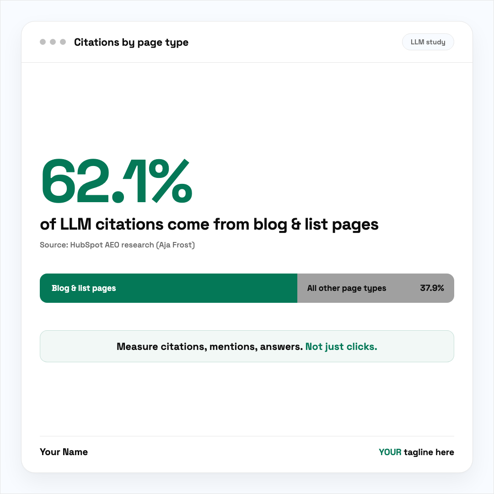
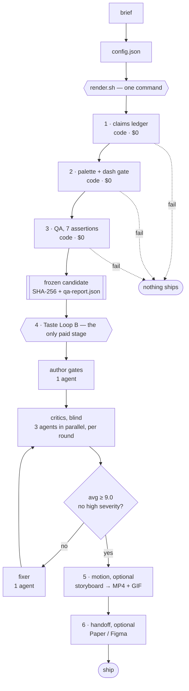

# linkedin-visual-pipeline

**LinkedIn visuals pipeline: from prompt idea to live post, with critics and iterations.**


A Claude Code plugin that turns a brief into a ship-ready social visual on **your** brand, and
checks its own work hard enough that you can trust the result.

*(That banner was rendered by this pipeline, from
[`assets/social-preview.config.json`](assets/social-preview.config.json). It is the shortest
proof the tool works.)*

Two halves:

- **Still** — PNG cards and swipeable PDF carousels
- **Motion** — looping MP4 for the feed, plus a GIF that fits LinkedIn's pixel budget

Every colour, typeface and footer comes from one `brand.json`. Nothing is hardcoded to any
company, so pointing it at a different brand file re-skins every format.

**Example output**, rendered from [`examples/bar-card.example.json`](examples/bar-card.example.json)
with the stock brand (swap `brand.json` and the colours, type and footer change):



## Install

**Paste this to your agent.** It is self-contained and stops at the first step that does not actually work.

```text
Set up the linkedin-visual-pipeline plugin for me.

1. Clone it. The skills run scripts from the repo, so a plugin install on its own cannot render:
     git clone https://github.com/antonvnukov/linkedin-visual-pipeline.git && cd linkedin-visual-pipeline

2. Register it as a plugin so /visual and /animate exist in my session:
     /plugin marketplace add antonvnukov/linkedin-visual-pipeline
     /plugin install linkedin-visuals

3. `cp brand.example.json brand.json`, then walk me through filling it in: palette, font,
   footer, avatar. Nothing here is hardcoded to a company — that one file is the entire skin,
   and it is gitignored, so every install starts by writing it.

4. `bash scripts/setup.sh`
   Installs Playwright + Chromium (~100MB, a few minutes), then proves the install by rendering
   a real card. If it prints MISSING for anything, fix that before continuing; it tells you the
   exact command.

5. Prove it end to end on my brand:
     bash scripts/render.sh examples/bar-card.example.json test ./out
   Success = out/test-light.png and out/test-dark.png exist and carry MY colours. This command
   refuses to ship a card that fails the claims ledger, the palette gate or the QA assertions,
   so a failure here is the tool working — read what it printed rather than working around it.

Then read skills/visual-pipeline/formats.md and help me write my first real config.
```

By hand, the same thing is six commands:

```bash
git clone https://github.com/antonvnukov/linkedin-visual-pipeline.git && cd linkedin-visual-pipeline
cp brand.example.json brand.json      # then edit: palette, font, footer, avatar
bash scripts/setup.sh                 # deps, then a real render as proof
bash scripts/render.sh examples/bar-card.example.json test ./out
# in a Claude Code session, for /visual and /animate:
#   /plugin marketplace add antonvnukov/linkedin-visual-pipeline
#   /plugin install linkedin-visuals
```

## Use

```bash
cp brand.example.json brand.json     # palette, font, footer, avatar
bash scripts/render.sh examples/bar-card.example.json mycard ./out
```

In a session: `/visual` for stills, `/animate` for motion.

## Formats

| `format` | Canvas | Ships as |
|---|---|---|
| `card-bar` | 1080x1080 | one hero stat + a part-to-whole bar |
| `card-dashboard` | 1080x1080 | metric tiles + a segment strip |
| `card-flow` | 1080x1080 | four ordered steps in a connected 2x2 grid |
| `card-before-after` | 1080x1080 (opt-in 1080x1350) | full-bleed split, two columns and a gap marker |
| `card-email` | 1080x1080 | a centred template card |
| `card-quote` | 1080x1080 | hero stat + quote |
| `card-infographic` | 1080x1350 | a reference sheet read along one path |
| `carousel` | 1080x1080 or 1080x1350 | N slides as a PDF document post (slide types incl. `versus`, `dotmatrix`, `verdict`) |

`"treatment": "brutalist"` is a posture, not a format: an opt-in config key on `carousel`,
`card-flow` and `card-before-after` (zero radius, visible compartments, bracket framing,
registration marks). The brand layer does not change. See formats.md.

Palette and type come from `brand.json` only. `DESIGN-BRIEF.md` is generated from it
(`python3 scripts/design-brief.py`, add `--paste` for an agent with no filesystem); never copy
brand values into another file.

The bar and dashboard cards can also emit MP4 + GIF; the quote card is static for now
(`quote-card.py` has no motion path — it refuses `--motion` rather than faking one). Field schemas:
[skills/visual-pipeline/formats.md](skills/visual-pipeline/formats.md).

## The pipeline



Stages 1 to 3 and 5 are code: free, so they run on every render forever and nobody ever weighs
whether it is worth it. Only stage 4 pays for judgment.

| Stage | Decided by | Agents | What stops the build |
|---|---|---|---|
| 1 claims ledger | `claims.py` | 0 | a rendered figure with no verified source |
| 2 palette + dash gate | `gate.sh` | 0 | an off-brand hex, an em dash, an AI-slop tell |
| 3 QA | `qa-visual.cjs` | 0 | wrong dimensions, unloaded image, wrong computed font, text clipped or overflowing |
| 4 taste loop | 3 independent critics | 1 + 4 or 5 per round | score below 9.0, or any high-severity finding |
| 5 motion | `motion-check.py` | 0 | no storyboard, broken loop seam, GIF over LinkedIn's pixel budget |

**Agent count for a real run.** One gate author, then per round: one brief assembler, three
critics in parallel, and one fixer (skipped on the round that converges). A run that converges
in two rounds is **10 agents**; the ceiling at three rounds is 15. After two stalled rounds the
critics escalate to the expensive tier automatically. Every critic reviews the *same frozen
bytes* and must verify the SHA-256 before it is allowed to score.

In Claude Code, `/workflows` shows each of those agents live while the loop runs, with its
label (`critic:r2-3`, `fix:r1`) and phase.

1. **Render** from a config. Never hand-author a card, or the gate and the loop have nothing
   to hold onto. `render.sh` will not ship a card that fails any check below, and the PNG it
   ships is copied out of the QA candidate itself, so artifact and evidence are the same pixels.
2. **Claims ledger** — every figure gets a classification, a source, and a cap on how often it
   may appear prominently, in `<config>.claims.json`. Enforced by counting, not by intention:
   a config that renders figures does not render without a verified ledger.
3. **QA gate** — seven deterministic assertions (dimensions, images, computed font per weight,
   palette both ways, text overflow, ancestor clipping) plus manifest text and geometry checks.
   Emits a review bundle into an immutable, checksummed candidate directory per run.
   (Carousels run the palette, dash and claims gates; the per-slide QA bundle is not built yet.)
4. **Taste Loop B** — the candidate is frozen and checksummed, independent critics review it
   blind against numbered gates, and it iterates until it scores 9.0+ with no high-severity
   issue. The best-graded version ships, not the last one.
5. **Motion** (optional) — requires a storyboard, asserts the loop seam and the GIF budget.
6. **Handoff** (optional) — push gated output to Paper or Figma to keep tuning by hand.

Everything above except step 4 is code, so it costs nothing and runs on every render.

## Cost

Model routing lives in `pipeline.json`, the only file that names a model. Cheap tiers do
extraction and drafting; only the critic rounds pay for judgment.

```bash
python3 scripts/routing.py                       # show the routing
python3 scripts/routing.py --report-cost u.jsonl # price a usage log you provide
```

`--report-cost` prices a JSONL usage log against `pipeline.json`'s rate table. Nothing
produces that log automatically: the loop's agents cannot see their own token bill, so
usage is recorded by whoever runs the loop (`log_usage()` in `scripts/routing.py`, or your
platform's usage accounting). The measurement below was taken the second way.

`scripts/calibrate.py` pins the cheapest critic tier that catches every seeded defect with no
false positive on a clean control. Until it has run, `pipeline.json` reports
`calibratedAt: null` and the tier is an untested default rather than a measurement.

### Cost of one run

One card, two rounds, three critics per round: **994,505 tokens** — recorded once, from the
session token accounting of the first live loop run on 2026-08-07. It is one observed data
point, not a benchmark, and it is not reproducible from this repo: no usage log is committed
here. Measure your own with `--report-cost` on a log you record.

| stage | tokens | share |
|---|---|---|
| critics (6 calls) | 643,052 | 65% |
| fixer | 123,138 | 12% |
| brief assembly (2) | 146,663 | 15% |
| gate authoring | 81,652 | 8% |

Routed per `pipeline.json` that is roughly **$3.20 per card**; run entirely on the top tier it
is roughly **$6**. The dollar figures are derived from the token count with an assumed input
split, so the token count is one observed run and the dollars an estimate layered on top of it.

The critics dominate, and they are irreducible: each one downscales the render, measures cap
heights and pixel bands, and checks eighteen gates. Everything deterministic already runs for
free before they are invoked, which is what keeps this a per-card cost rather than a per-check one.

## Why it is built this way

[docs/how-it-works.md](docs/how-it-works.md) — one section per stage: what goes in, what
happens, what comes out, and the reasoning. Short version: rigor that costs too much gets
skipped, so anything a computer can decide is code and only judgment pays for a model.

## Self-checks

Every non-trivial component ships a two-sided check: it must catch a seeded defect **and** pass
a known-clean control.

```bash
python3 scripts/brandkit.py          # brand resolution
python3 scripts/routing.py           # model routing + cost accounting
node    scripts/qa-visual.cjs --self-test
python3 scripts/claims.py            # ledger, incl. "a draft must not pass"
python3 scripts/motion-check.py      # GIF budget + loop seam
python3 scripts/storyboard.py        # template rejected, filled accepted
python3 scripts/gates.py             # gate assembly
python3 scripts/check-spec.py        # Agent Plugins + Agent Skills conformance
python3 scripts/check-spec.py --self-test
python3 scripts/layout-check.py --self-test   # canvas fill + whole-deck top-edge drift
python3 scripts/brand-drift.py  --self-test   # every mirrored palette copy vs brand.json
python3 scripts/design-brief.py --self-test   # the generated brief holds no foreign hex
```

## Chaining with a content pipeline

This renders the visual; it does not decide what to say. If your words come from a content
pipeline, [docs/chaining.md](docs/chaining.md) documents the seam - which post elements map to
which config fields, and why that is a chain rather than a dependency.

## What it does not do

Generated imagery, copywriting, or posting. It renders typographic data-driven cards from
structured config, checks them, and stops before anything is published.

## License

MIT.

**Motion gates (added 2026-09-28).** Every motion render also runs a lossless loop-seam check (`motion-check.py seam-frames`, blocks), a motion-variety check (`motion-variety.py`, blocks an identical signature, warns on a novelty drought) and two report-only checks (`excursion`, `dead-hold`). Details: `skills/visual-pipeline/formats.md`.
